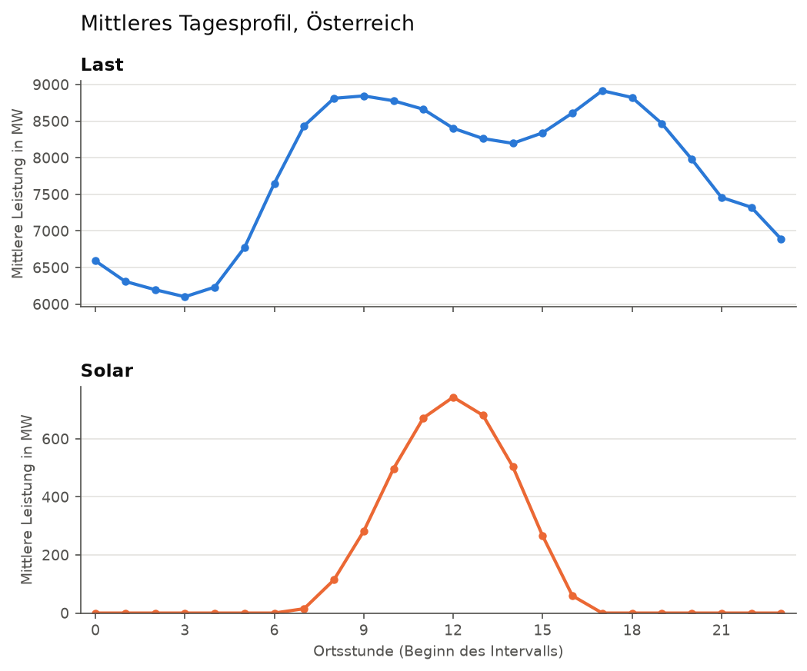
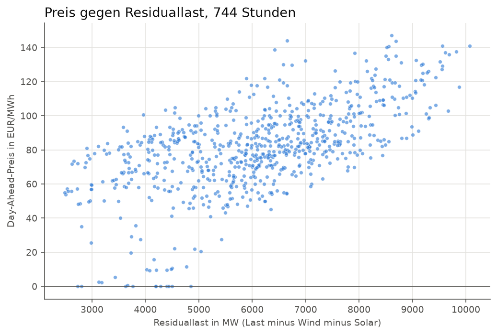

# strommix-at

Analyse des österreichischen Stromsystems im Jänner 2024 mit Python und SQL: Woher kommt
der Strom, wie verläuft der Verbrauch über den Tag, und was verdienen Solaranlagen und
Pumpspeicher am Markt?

Das Projekt lädt Viertelstundenwerte von einer öffentlichen Schnittstelle in eine
DuckDB-Datenbank, prüft sie mit vier SQL-Abfragen auf Fehler und beantwortet fünf
Fragen mit SQL.



## Ergebnisse

| Frage | Ergebnis für Jänner 2024 |
| --- | --- |
| Woher kommt der Strom? | Laufwasser lieferte 46.39 % der Erzeugung, fossiles Gas 20.67, Wind 19.78 % und Solar 2.04 %. |
| Wie verläuft der Verbrauch über den Tag? | Die Last ist um 3 Uhr am niedrigsten (6101.44 MW) und um 17 Uhr am höchsten (8916.17 MW). Solar erreicht um 12 Uhr im Mittel 743.39 MW. |
| Wann ändert sich die Residuallast am schnellsten? | Die steilste Änderung lag am 18.01.2024 um 21 Uhr: -810 MW in 15 Minuten. |
| Was verdient Solarstrom am Markt? | Der Durchschnittspreis lag bei 81.33 EUR/MWh, Solarstrom erzielte im Mittel 80.33 EUR/MWh, also einen Wertfaktor von 99 %. |
| Pumpen die Speicher billig und erzeugen teuer? | Beim Pumpen lag der Preis im Mittel bei 48.39 EUR/MWh, beim Erzeugen bei 101.32 EUR/MWh. Gepumpt wurden 205599 MWh, erzeugt 510396 MWh. |

Dass die Pumpspeicher im Jänner rund 2,5-mal mehr erzeugen als pumpen, ist kein
Wirkungsgrad über 100 %. Wahrscheinlich haben die großen alpinen Pumpspeicher auch
natürlichen Zufluss und leeren im Winter die im Sommer gefüllten Speicherseen.



## Validierung

Vor den Auswertungen prüfen vier Abfragen in `sql/checks/` die Daten. Jede gibt die
fehlerhaften Zeilen zurück, ein leeres Ergebnis bedeutet „bestanden“.

| Prüfung | Was sie sucht |
| --- | --- |
| `01_residuallast` | Abweichungen zwischen eigener Residuallast (Last minus Wind minus Solar) und der Reihe des Anbieters |
| `02_luecken` | Zeitpunkte, deren Nachfolger nicht genau 15 Minuten später liegt |
| `03_vorzeichen` | negative Erzeugung, positiver Pumpbetrieb, Last kleiner oder gleich null |
| `04_fehlende_werte` | fehlende Messwerte je Reihe |

Für den Jänner 2024 bestehen alle vier Prüfungen. Die selbst berechnete Residuallast
stimmt in allen 2.976 Viertelstunden mit der des Anbieters überein.

## Daten

Quelle ist die öffentliche Schnittstelle von [Energy-Charts](https://www.energy-charts.info)
(Fraunhofer ISE). Verwendet werden zwei Endpunkte für Österreich:

| Endpunkt | Inhalt | Einheit | Auflösung |
| --- | --- | --- | --- |
| `public_power` | Erzeugung je Kraftwerksart, Last, Speicher, Stromhandel | MW (mittlere Leistung im Intervall) | 15 Minuten |
| `price` | Day-Ahead-Preis der Gebotszone AT | EUR/MWh | 60 Minuten |

Die Preisdaten stammen laut Schnittstelle von Bundesnetzagentur | SMARD.de und stehen
unter der Lizenz CC BY 4.0.

### Was bei diesen Daten zu beachten ist

- **Zeit:** Die Zeitstempel sind Unix-Sekunden in UTC und markieren den Beginn des
  Intervalls. Der erste Wert des 1. Jänner 2024 ist 23:00 UTC am Vortag, also
  Mitternacht in Wien.
- **Leistung und Energie:** Die Werte sind Leistungen. Energie in MWh ergibt sich aus
  Leistung mal Intervalllänge, bei Viertelstunden also MW mal 0.25 h.
- **Vorzeichen:** Der Pumpbetrieb der Speicher (`Hydro pumped storage consumption`) ist
  null oder negativ, weil er dem Netz Leistung entnimmt. Beim Stromhandel ist Import
  positiv und Export negativ.
- **Verschiedene Auflösung:** Zu einem Stundenpreis gehören vier Leistungswerte. Vor dem
  Verbinden wird die Leistung über die Stunde gemittelt.

### Kategorien der Reihen

| Kategorie | Reihen |
| --- | --- |
| Erzeugung | Hydro Run-of-River, Hydro water reservoir, Wind onshore, Solar, Biomass, Geothermal, Waste, Fossil gas, Others |
| Speicher | Hydro pumped storage, Hydro pumped storage consumption |
| Handel | Cross border electricity trading |
| Last | Load |
| Abgeleitet | Residual load, Renewable share of load, Renewable share of generation |

Die abgeleiteten Reihen berechnet der Anbieter selbst, zwei davon sind Prozentwerte. Sie
gehen in keine Summe ein und dienen nur dazu, die eigenen Berechnungen zu überprüfen.

## Aufbau

| Datei oder Ordner | Aufgabe |
| --- | --- |
| `load.py` | ruft die Daten ab und schreibt sie in die Datenbank |
| `validate.py` | führt alle Prüfungen in `sql/checks/` aus |
| `run_sql.py` | führt eine einzelne SQL-Datei aus und zeigt das Ergebnis |
| `plots.py` | erstellt die beiden Grafiken in `figures/` |
| `sql/checks/` | vier Prüfabfragen |
| `sql/auswertung/` | fünf Auswertungen, eine pro Frage |

`load.py` schreibt drei Tabellen in die Datei `data/strommix.duckdb`:

| Tabelle | Eine Zeile ist | Spalten |
| --- | --- | --- |
| `power` | ein Zeitpunkt und eine Reihe | `time_key`, `ts_utc`, `ts_local`, `series`, `value_mw` |
| `price` | ein Zeitpunkt | `time_key`, `ts_utc`, `ts_local`, `price_eur_mwh` |
| `series_category` | eine Reihe | `series`, `category` |

`time_key` sind die Unix-Sekunden der Quelle und dienen als Schlüssel für Joins.
`ts_local` ist die Wiener Uhrzeit und dient zum Gruppieren nach Tagesstunde.

Die Antworten der Schnittstelle werden unverändert unter `data/raw/` abgelegt und bei
einem weiteren Lauf wiederverwendet. Die Tabellen werden bei jedem Lauf neu aufgebaut,
sodass wiederholtes Laden keine doppelten Zeilen erzeugt.

## Starten

Voraussetzung ist Python 3.11 oder neuer. Befehle für Windows (PowerShell):

```powershell
python -m venv .venv
.venv\Scripts\Activate.ps1
pip install -r requirements.txt

python load.py                                              # Daten für Jänner 2024 laden
python validate.py                                          # Prüfungen ausführen
python run_sql.py sql\auswertung\01_energie_pro_quelle.sql  # eine Auswertung anzeigen
python plots.py                                             # Grafiken erstellen
```

Ein anderer Zeitraum lässt sich als erster und letzter Tag angeben:

```powershell
python load.py 2024-01-01 2024-01-01
```

Für den 1. Jänner 2024 meldet `load.py` 1536 Zeilen in `power` (96 Zeitpunkte mal
16 Reihen) und 24 Zeilen in `price`.

## Grenzen

- Nur Österreich und nur ein Monat. Der Jänner ist ein Wintermonat mit wenig Solarstrom;
  die Ergebnisse lassen sich nicht auf das ganze Jahr übertragen.
- Die Zuordnung der Reihen zu Kategorien ist von Hand festgelegt. Liefert die
  Schnittstelle eine unbekannte Reihe, bricht `load.py` mit einer Fehlermeldung ab.
- Die Auswertungen 4 und 5 setzen stündliche Preise voraus. Bei Preisen in
  Viertelstunden müssten beide Seiten auf dieselbe Auflösung gebracht werden.
- `ts_local` ist in der Nacht der Zeitumstellung im Oktober nicht eindeutig. Für den
  Jänner spielt das keine Rolle.
- Keine automatisierten Tests.

## Mögliche Erweiterungen

- Automatisierte Tests mit pytest und ein Ablauf mit GitHub Actions
- Ein ganzes Jahr statt eines Monats, um Sommer und Winter zu vergleichen
- Vergleich mit den Daten des österreichischen Übertragungsnetzbetreibers
  [APG](https://markt.apg.at/en/transparency)
